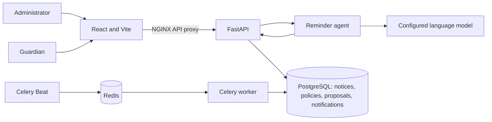
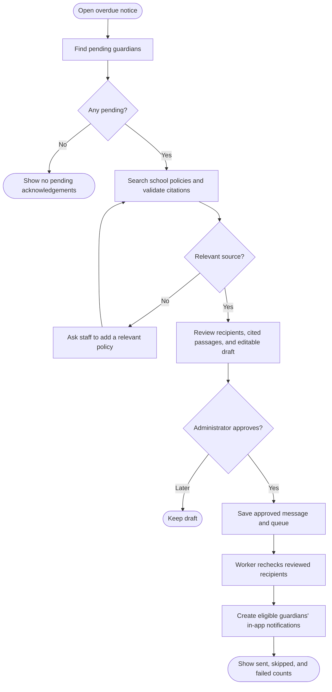
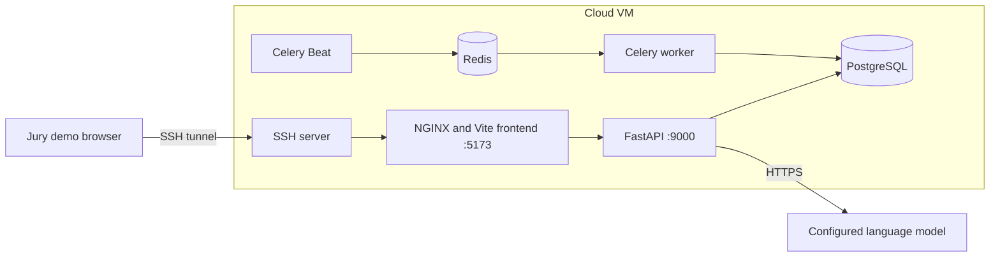

# Review and Execute

The administrator opens an overdue notice from **Needs Review** and chooses **Use standard reminder** for an editable template. **Draft from school policy** asks the agent to read the notice, search policy passages, and draft a message with citations. Both options show the editable message and recipient list before approval. Approval records the message and queues delivery. The worker rechecks acknowledgements and creates notifications for the guardians who are still eligible.

This version sends one in-app reminder per guardian per notice. PostgreSQL full-text search ranks passages within the authenticated school. Citation IDs come from the retrieved passages and are checked before saving a draft. A draft and its approval are stored separately from each recipient's delivery outcome.

## Component diagram



## Activity diagram



## Deployment diagram



## Run on a demo VM

Keep the backend and frontend directories next to each other, as in the workspace. Use a VM with Docker and the Compose plugin. Configure the existing WorkOS integration and a server-side `OPENROUTER_API_KEY` or `OPENAI_API_KEY` in the backend Compose environment. For a private demo, keep the published Compose ports behind the VM firewall and allow access through SSH.

From the backend directory on the VM:

```shell
docker compose --env-file docker/.env -f docker/docker-compose.yml up -d db redis
docker compose --env-file docker/.env -f docker/docker-compose.yml run --rm api python -m alembic upgrade head
docker compose --env-file docker/.env -f docker/docker-compose.yml up -d --build
docker compose --env-file docker/.env -f docker/docker-compose.yml logs -f worker scheduler
```

From the demo computer, use `ssh -N -L 5173:127.0.0.1:5173 user@vm-host`, then open `http://localhost:5173`. The frontend proxies API requests to FastAPI. Celery Beat checks approved proposals every 15 seconds.

## Demo scenario

Create a notice called **New pickup instructions**, require acknowledgement, and set a deadline shortly in the future. Have one demo guardian acknowledge the notice, then wait for the deadline to pass. Open the overdue notice from **Needs Review**. Under **School policies**, add this synthetic policy as **Pickup and dismissal**.

```text
# Pickup acknowledgement
Guardians must acknowledge new pickup instructions through the school portal.
If they cannot access the portal, ask them to contact the school office.
```

Select **Draft from school policy** with two guardians still pending. Have the second guardian acknowledge while the proposal is still open. Review the source passage, edit the draft, and approve. The admin should see one skipped and one sent, and the third guardian should see the approved text in Notifications. Refresh the result after another scheduler cycle to confirm the counts remain unchanged.
